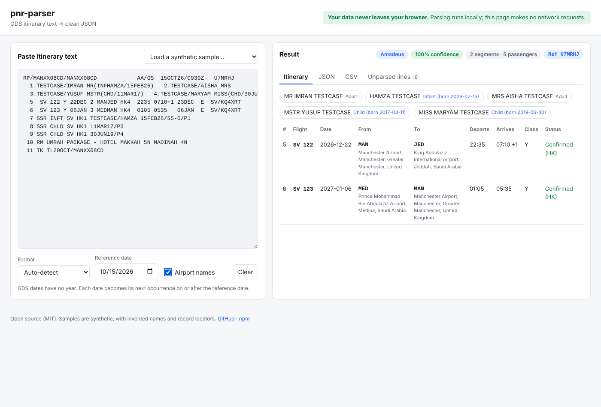

# pnr-parser

**Turn pasted Galileo/Travelport, Sabre and Amadeus itinerary text into clean, typed JSON, with clear warnings for anything it could not read.**

[](https://github.com/lalchand07/pnr-parser/actions/workflows/ci.yml)
[](https://www.npmjs.com/package/pnr-parser)
[](LICENSE)

**▶ Try it in your browser: [Playground](https://lalchand07.github.io/pnr-parser/)** <!-- TODO: confirm the URL once GitHub Pages is enabled -->

<!-- Screenshot placeholder: replace docs/playground-screenshot.png with an up-to-date capture. -->



Travel agents copy itinerary displays out of GDS terminals and into spreadsheets,
CRMs and e-mails every day. `pnr-parser` reads that text and returns segments,
passengers and the record locator. Anything it cannot read comes back as
warnings and unparsed lines rather than being guessed at or dropped.

- **Zero runtime dependencies**, TypeScript types included, ESM + CommonJS.
- **Runs anywhere**: Node 20+, browsers, edge runtimes. The core has no Node-only APIs.
- **Never throws**: problems are reported as specific warnings, e.g. `Line 4: could not read arrival time`.
- **Nothing is silently dropped**: every non-blank line ends up in a segment, a passenger or `unparsedLines`.
- **Private by design**: no network access. The [playground](#playground) runs entirely in your browser.

## Install

```sh
npm install pnr-parser
```

## 30-second example

```ts
import { parsePnr, toSimpleItinerary, segmentsToCsv } from 'pnr-parser';

const text = `
RP/LONXX21AB/LONXX21AB            AA/SU  12OCT26/0915Z   ZQ7TKD
  1.SAMPLE/JOHN MR   2.SAMPLE/ADAM MSTR(CHD/05JAN18)
  3  BA 117 Y 15DEC 2 LHRJFK HK2  1020 1315   15DEC  E  BA/YT4KQ9
  4  BA 112 Y 22DEC 2 JFKLHR HK2  1900 0655+1 23DEC  E  BA/YT4KQ9
  5 AP LON 020 7946 0000 - A
`;

const result = parsePnr(text, { referenceDate: '2026-10-15' });

result.format; // 'amadeus'
result.confidence; // 1
result.recordLocator; // 'ZQ7TKD'
result.passengers[1]; // { id: '2', surname: 'SAMPLE', givenName: 'ADAM', title: 'MSTR', type: 'CHD', dateOfBirth: '2018-01-05', … }
result.segments[1];
// {
//   segmentNumber: 4, airline: 'BA', flightNumber: '112', bookingClass: 'Y',
//   departureDate: '2026-12-22', departureDateRaw: '22DEC', origin: 'JFK', destination: 'LHR',
//   departureTime: '19:00', arrivalTime: '06:55', arrivalDayOffset: 1, arrivalDate: '2026-12-23',
//   status: 'HK', statusMeaning: 'Confirmed', statusCategory: 'confirmed', seats: 2,
//   airlineLocator: 'YT4KQ9', lines: [5], raw: '  4  BA 112 Y 22DEC …'
// }
result.unparsedLines; // [{ line: 2, text: 'RP/LON…', category: 'header' }, { line: 6, text: '  5 AP LON…', category: 'contact' }]
result.warnings; // []

console.log(toSimpleItinerary(result).text);
// Booking reference: ZQ7TKD
// Passengers: MR JOHN SAMPLE, MSTR ADAM SAMPLE (child)
//
// #  Flight  Date        From  To   Departs  Arrives   Class  Status
// 3  BA 117  2026-12-15  LHR   JFK  10:20    13:15     Y      Confirmed (HK)
// 4  BA 112  2026-12-22  JFK   LHR  19:00    06:55 +1  Y      Confirmed (HK)

segmentsToCsv(result); // RFC 4180 CSV, one row per segment, safe to open in Excel/Sheets
```

CommonJS works too: `const { parsePnr } = require('pnr-parser');`

## Supported formats

| GDS                  | Displays            | Status | Notes                                                                                                               |
| -------------------- | ------------------- | ------ | ------------------------------------------------------------------------------------------------------------------- |
| Amadeus              | `RT` (PNR retrieve) | beta   | Shared element numbering, digit day-of-week, `+1` offsets, printed arrival dates, `(CHD…)`/`(INF…)` names.          |
| Sabre                | `*I`, `*IA`, `*A`   | beta   | Letter day-of-week, 12-hour times (`1020A`, `1200N`), `¥1` offsets, `/DCxx*LOC` airline locators, section headings. |
| Galileo / Travelport | `*I`, `*R`          | beta   | Dotted segment numbers, `#` next-day marker, agency header line, `FONE-`/`TKTG-`/`GFAX-` fields.                    |
| Auto-detection       | all of the above    | beta   | Weighted evidence per line, with a `confidence` score from 0 to 1. Override with `format`.                          |

**Why "beta"?** Every format was implemented from general knowledge of these
displays and is tested against **synthetic** samples only. Each uncertain detail is
written down in [docs/FORMAT_NOTES.md](docs/FORMAT_NOTES.md). A format becomes
"stable" once anonymized real-world samples confirm it. [Please help](#contributing-samples).

## API

### `parsePnr(text, options?) → ParseResult`

| Option           | Type                                          | Default  | Description                                                        |
| ---------------- | --------------------------------------------- | -------- | ------------------------------------------------------------------ |
| `format`         | `'auto' \| 'galileo' \| 'sabre' \| 'amadeus'` | `'auto'` | Force a format. Confidence then reports how well the text fits it. |
| `referenceDate`  | `Date \| 'YYYY-MM-DD'`                        | today    | Used to infer years. See [year inference](#year-inference).        |
| `maxInputLength` | `number`                                      | `200000` | Longer input is truncated with an `INPUT_TRUNCATED` warning.       |

### `detectFormat(text) → { format, confidence, scores }`

Detection only, without the full parse.

### `toSimpleItinerary(result) → { recordLocator?, passengers: string[], segments: Row[], text }`

Display-ready strings, e.g. `{ flight: 'BA 117', date: '2026-12-15', departs: '10:20', arrives: '06:55 +1', status: 'Confirmed (HK)', note: 'Operated by AMERICAN AIRLINES' }`,
plus an aligned plain-text table in `text`.

### `segmentsToCsv(result, { delimiter?, eol?, header? }) → string`

One row per segment. Cells that a spreadsheet would treat as a formula (`=`,
`+`, `-`, `@`) are prefixed with `'`, which prevents CSV injection.

### `describeStatus(code)` / `SEGMENT_STATUS`

The status-code table: `describeStatus('HL') → { meaning: 'Waitlisted', category: 'waitlisted' }`.

## Output reference

```ts
interface ParseResult {
  format: 'galileo' | 'sabre' | 'amadeus' | 'unknown';
  confidence: number; // 0..1
  formatForced: boolean;
  referenceDate: string; // the YYYY-MM-DD actually used
  recordLocator?: string;
  passengers: Passenger[];
  segments: Segment[];
  warnings: ParseWarning[];
  unparsedLines: UnparsedLine[];
}
```

**Segment**

| Field                                       | Example                                             | Notes                                                                                    |
| ------------------------------------------- | --------------------------------------------------- | ---------------------------------------------------------------------------------------- |
| `segmentNumber`                             | `3`                                                 | As printed. For Amadeus this is the element number.                                      |
| `airline`, `flightNumber`, `bookingClass`   | `'BA'`, `'117'`, `'Y'`                              | Flight number without leading zeros.                                                     |
| `departureDate` / `departureDateRaw`        | `'2026-12-15'` / `'15DEC'`                          | Year inferred.                                                                           |
| `origin`, `destination`                     | `'LHR'`, `'JFK'`                                    |                                                                                          |
| `departureTime`, `arrivalTime`              | `'10:20'`                                           | 24-hour local times; omitted (with a warning) when unreadable.                           |
| `arrivalDayOffset`, `arrivalDate`           | `1`, `'2026-12-16'`                                 | Offset can be `-1`, `0`, `1`, `2`.                                                       |
| `status`, `statusMeaning`, `statusCategory` | `'HK'`, `'Confirmed'`, `'confirmed'`                | Category: `confirmed`, `waitlisted`, `requested`, `unconfirmed`, `cancelled`, `unknown`. |
| `seats`                                     | `2`                                                 | Number in party, when shown.                                                             |
| `operatingCarrier?`                         | `{ name: 'AMERICAN AIRLINES' }` or `{ code: 'AA' }` | From `OPERATED BY` lines.                                                                |
| `equipment?`                                | `'77W'`                                             | Only when shown and recognised.                                                          |
| `airlineLocator?`                           | `'YT4KQ9'`                                          | Sabre `/DCBA*…`, Amadeus `BA/…`.                                                         |
| `lines`, `raw`                              | `[3]`, original text                                | Every input line this segment consumed.                                                  |

**Passenger**

| Field                               | Example                              | Notes                                                                                                                  |
| ----------------------------------- | ------------------------------------ | ---------------------------------------------------------------------------------------------------------------------- |
| `id`                                | `'1.1'`, `'2'`, `'1.INF'`            | Name element as printed.                                                                                               |
| `surname`, `givenName`, `title?`    | `'SAMPLE'`, `'JOHN'`, `'MR'`         | Titles: `MR MRS MS MSTR MISS DR`.                                                                                      |
| `type`                              | `'ADT' \| 'CHD' \| 'INF'`            |                                                                                                                        |
| `typeSource`                        | `'explicit' \| 'title' \| 'default'` | `explicit` = a marker like `*C08`, `(CHD…)`, `I/`, `INF`. `title` = `MSTR` implies a child. `default` = assumed adult. |
| `typeCode?`, `age?`, `dateOfBirth?` | `'C08'`, `8`, `'2018-01-05'`         | When printed.                                                                                                          |
| `associatedPassengerId?`            | `'1'`                                | Amadeus infants: the adult they travel with.                                                                           |
| `line`, `raw`                       |                                      |                                                                                                                        |

**Warnings** are `{ code, message, line? }`. Codes: `EMPTY_INPUT`, `INPUT_TRUNCATED`,
`UNKNOWN_FORMAT`, `LOW_CONFIDENCE`, `FORMAT_MISMATCH`, `NO_SEGMENTS`,
`SEGMENT_FIELD_MISSING`, `INVALID_TIME`, `INVALID_DATE`, `UNKNOWN_STATUS`,
`DAY_OF_WEEK_MISMATCH`, `NON_CHRONOLOGICAL`, `ARRIVAL_DATE_CONFLICT`,
`WRAPPED_LINE_JOINED`, `SEGMENT_NUMBER_MISSING`, `NAME_UNPARSED`,
`INVALID_OPTION`, `INTERNAL_ERROR`.

**Unparsed lines** are `{ line, text, category }`, where category is one of `header`, `remark`,
`ssr`, `osi`, `ticketing`, `fare`, `contact`, `arnk`, `non-air-segment` or `unknown`.

## Year inference

GDS displays print `15DEC` with no year. pnr-parser infers the year as follows:

1. **Next occurrence on or after `referenceDate`.** With the default
   (today, using the local calendar date), `15DEC` on 2026-10-15 is 2026-12-15,
   and `14OCT` is 2027-10-14. A date equal to the reference date stays in the
   same year.
2. **December → January wraps naturally.** With a reference date of 2026-12-20,
   `28DEC` → 2026-12-28 and `05JAN` → 2027-01-05.
3. **29FEB** moves to the next leap year (`INVALID_DATE` warning).
4. **Arrival dates** are departure date + `arrivalDayOffset`. The offset comes
   from markers like `+1`, `#`, `¥1` or `-1`, or from a printed arrival date
   (Amadeus). If both are printed and disagree, the parser uses the marker and
   warns (`ARRIVAL_DATE_CONFLICT`).
5. **Each segment is inferred independently.** Segments that go backwards in
   time raise `NON_CHRONOLOGICAL`. This usually means the trip has already
   started: pass a `referenceDate` on or before the first flight, such as the
   booking date.
6. **Day-of-week check.** Sabre and Amadeus print the weekday next to the date.
   If it does not match the inferred date, you get `DAY_OF_WEEK_MISMATCH`, which
   is a strong hint that the year is wrong.

Use a fixed `referenceDate` when processing stored or historical text. "Today"
is only right for live bookings.

## CLI

```sh
npx pnr-parser < itinerary.txt                      # JSON
npx pnr-parser --reference-date 2026-10-15 file.txt # fixed year inference
npx pnr-parser --format sabre --csv < itinerary.txt > segments.csv
pbpaste | npx pnr-parser --text                     # quick table
npx pnr-parser --enrich < itinerary.txt             # add airport names
```

Flags: `-f/--format`, `-r/--reference-date`, `--csv`, `--text`, `--enrich`,
`--compact`, `-h/--help`, `-v/--version`. In `--csv` and `--text` modes, warnings go to stderr.

## Airport names (optional)

```ts
import { enrich, lookupAirport } from 'pnr-parser/enrich';

const enriched = enrich(result);
enriched.segments[0].originAirport; // { iata: 'LHR', name: 'London Heathrow Airport', city: 'London', countryCode: 'GB', country: 'United Kingdom' }
```

Airport data is a compact snapshot of [OurAirports](https://ourairports.com/data/)
(public domain), about 5,300 airports with IATA codes. It lives in a separate entry
point, so it is not loaded unless you import it.

**Airline names are not bundled.** No clearly licensed airline dataset could be
used for v0.1; [DATA_LICENSES.md](DATA_LICENSES.md) has the details. Pass your own
names instead: `enrich(result, { airlines: { BA: 'British Airways' } })`.

## Playground

`/playground` is a static Vite app. Paste text on the left, and the right side shows
the itinerary table, JSON, CSV, warnings and unparsed lines.

- **Your data never leaves your browser.** All parsing runs locally. The
  production build sets a Content-Security-Policy with `connect-src 'none'`, so
  the page cannot make network requests even by accident.
- Run it locally with `npm run playground:dev`. Every push to `main` deploys it to
  GitHub Pages (`.github/workflows/pages.yml`; enable Pages with "GitHub Actions" as
  the source in the repository settings).

## Privacy

PNR text contains personal data: names, phone numbers, e-mail addresses,
passport numbers in SSR DOCS lines, and more. pnr-parser:

- makes **no network requests** and has no telemetry;
- does not log or store input;
- returns the original text of every line (`raw`, `unparsedLines`). **Be
  careful what you persist or forward.** If you only need flights, keep only
  `segments`.

## Contributing samples

Real-world samples are the best way to improve accuracy, and they must be
**fully anonymized** first. Before sharing anything, read the
[anonymization checklist in CONTRIBUTING.md](CONTRIBUTING.md#anonymization-checklist).
Then open an [Unparsed format issue](https://github.com/lalchand07/pnr-parser/issues/new?template=unparsed_format.yml)
or a pull request that adds a fixture under `test/fixtures/<format>/` with
hand-written expectations in `test/fixtures.test.ts`.

```sh
npm install
npm test            # vitest: unit, fixture and property-based tests
npm run lint        # eslint + prettier
npm run typecheck
npm run build
```

## Roadmap

- [ ] Confirm formats with anonymized real samples and promote them to "stable"
- [ ] Ticket (`FA`, `TKT`) and EMD lines parsed into structured fields
- [ ] More GDS displays: Worldspan, Sabre `*IA` variants, Amadeus `RTSVC`/`TQT`, Travelport+ (1V/1P)
- [ ] Airline names from a clearly licensed source (e.g. Wikidata, CC0)
- [ ] MCP tool, so AI assistants can parse itineraries
- [ ] Python port
- [ ] PHP port

## Built by

_Your name / agency here._ <!-- TODO: add maintainer name and link -->

## License

[MIT](LICENSE). Airport data: OurAirports, public domain (see [DATA_LICENSES.md](DATA_LICENSES.md)).
